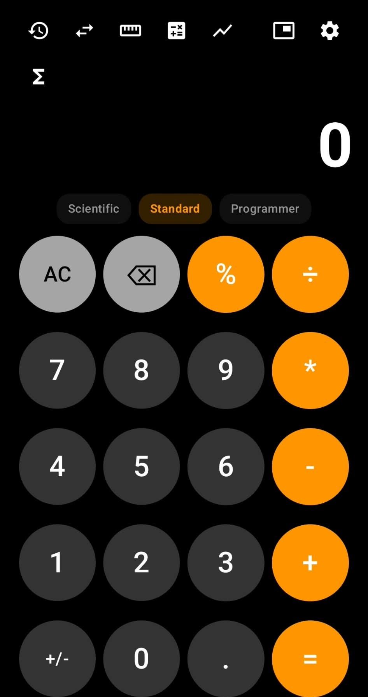
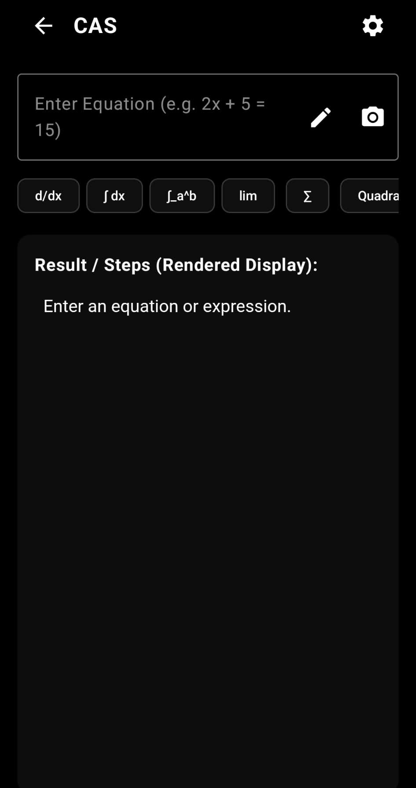
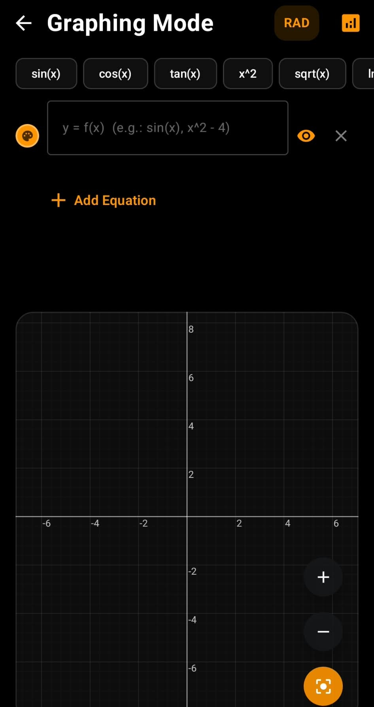
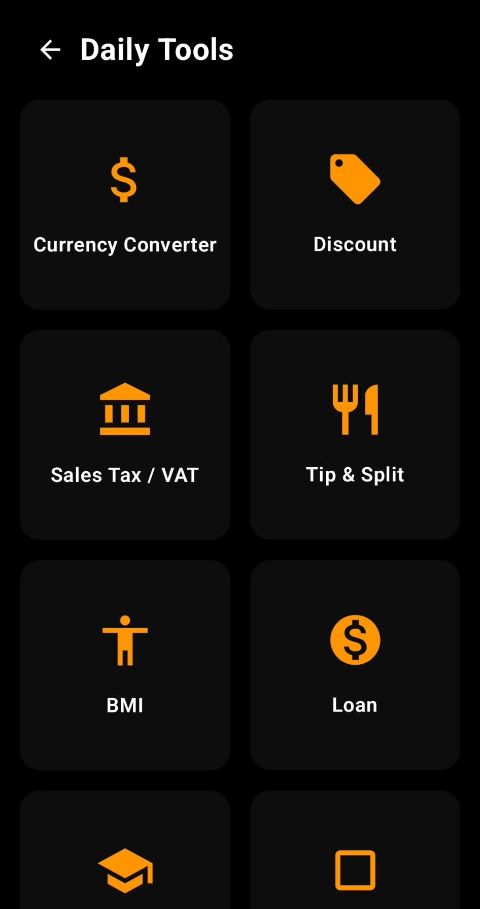

# CAS Calculator 🧮✨

[](https://kotlinlang.org)
[](https://www.android.com)
[](https://developer.android.com/jetpack/compose)
[](LICENSE)

An advanced, modern, and open-source all-in-one Android calculator designed with **Jetpack Compose** and **Material 3**. Featuring a full Computer Algebra System (CAS), real-time 2D graphing, Math Vision (Camera & Drawing OCR), daily utility tools, interactive home screen widgets, and an optional AI Math Assistant.

---

## 📱 Screenshots

<div align="center">
  <table>
    <tr>
      <td align="center"><b>Scientific Calculator</b></td>
      <td align="center"><b>Advanced CAS Engine</b></td>
      <td align="center"><b>2D Graphing Calculator</b></td>
      <td align="center"><b>Daily Utility Tools</b></td>
    </tr>
    <tr>
      <td></td>
      <td></td>
      <td></td>
      <td></td>
    </tr>
  </table>
</div>

---

## ✨ Features

### 📐 Standard & Scientific Calculator
- **Full Scientific Functions:** Trigonometry (`sin`, `cos`, `tan`, `cot`), inverse & hyperbolic functions, degrees / radians modes.
- **Logarithms & Powers:** Natural log (`ln`), base-10 log (`log`), arbitrary powers (`x^y`), square & cube roots, factorials (`x!`).
- **Programmer Mode:** Bitwise operations (`AND`, `OR`, `XOR`, `NOT`, bit shifts `<<`, `>>`) across Binary (`BIN`), Octal (`OCT`), Decimal (`DEC`), and Hexadecimal (`HEX`).
- **Dynamic Expression Editing:** Full interactive cursor positioning, undo, expression history with instant recall.

### 🧠 Advanced Computer Algebra System (CAS)
Powered by the **Symja** mathematical library and an integrated analytical engine:
- **Symbolic Differentiation:** First-order, higher-order ($d^n/dx^n$), multivariable partial derivatives, and step-by-step rule breakdowns (Power Rule, Product Rule, Quotient Rule, Chain Rule).
- **Integration:** Indefinite integrals, definite integrals with bounds, and improper integrals.
- **Limits:** Two-sided limits, one-sided limits ($x \to a^+$, $x \to a^-$), and limits at infinity ($\infty$).
- **Differential Equations (ODEs):** First-order and higher-order ODE solutions with initial value conditions (IVP).
- **Linear Algebra & Matrices:** Matrix arithmetic, determinants, inverses, transpose, eigenvalues, and eigenvectors.
- **Algebraic Solvers:** Real & complex polynomial roots, system of equations, inequalities, Diophantine integer equations, and arbitrary-precision calculations (e.g., 50 digits of $\pi$).
- **Live MathJax Rendering:** Beautiful dynamic LaTeX formula formatting preview.

### 📷 Math Vision & Drawing (OCR)
- **Camera & Gallery Scanner:** Extract mathematical equations directly from physical textbooks, handwritten notes, or whiteboard photos using on-device **Google ML Kit Text Recognition**.
- **Draw to Solve:** Interactive on-screen touch canvas to sketch formulas with your finger or stylus and solve them instantly.

### 🤖 Optional AI Math Assistant
- **Step-by-Step AI Explanations:** Seamlessly connects to Google Gemini (via Google AI Studio) or OpenAI API.
- **Privacy-First:** Strictly opt-in; requires the user to supply their own API key, and keys are stored securely in local app storage.

### 📊 Real-Time 2D Graphing Calculator
- High-performance real-time plotting of multiple 2D functions ($f(x)$).
- **Automatic Analysis:** Root detection, local extrema (minima/maxima), and equation intersection points.
- **Interactive Canvas:** Smooth pinch-to-zoom, pan, touch tracing pointer, and customizable 24-color swatch palette.

### 🔄 Unit Converter
Instant conversion across 10+ categories:
- Length, Mass & Weight, Temperature, Area, Volume, Speed, Time, Digital Storage, Energy, Pressure, and Angles.

### 📏 Screen Ruler
- Calibrated on-screen physical ruler supporting millimeters, centimeters, and fractional inches (1/16").
- Drag marker with tactile haptic tick feedback every 5mm.

### 🧮 Daily & Financial Utilities
- **Currency Converter:** Real-time exchange calculations.
- **Discount & VAT/Tax:** Quick price reduction and tax breakdown.
- **Tip Calculator:** Split bills and calculate tips per person.
- **Loan & Mortgage:** Monthly payment (EMI) and interest calculator.
- **BMI Calculator:** Body Mass Index analysis with health status indicator.
- **GPA / CGPA Calculator:** Course credit & grade point average tracker.
- **Area Calculator:** Geometry tools for triangles, circles, polygons, etc.
- **Date & Duration:** Calculate days, weeks, and durations between dates.
- **Custom Equations:** Save and evaluate your own custom parameterized formulas.

### 🪟 Floating Calculator & Home Screen Widgets
- **Picture-in-Picture Floating Window:** Floating calculator overlay over other apps.
- **12+ Home Screen Widgets:** Interactive Android widgets for Quick Calculator, Unit Converter, Ruler, BMI, Currency, Discount, VAT, Tip, Loan, GPA, Area, Date, and Custom Equations.

### 🎨 Customization & Localization
- **Themes:** Dark, Light, AMOLED Black, Neon, and Material You dynamic theming.
- **Sound & Haptics:** Keypress haptic intensity slider, custom audio tone synthesis with pitch variation.
- **Multilingual Support:** Available in 9 languages:
  - English, Türkçe, Español, Deutsch, Français, Русский, العربية, 中文, 日本語.

---

## 🛠️ Tech Stack & Architecture

- **Language:** [Kotlin 2.0](https://kotlinlang.org)
- **UI Framework:** [Jetpack Compose](https://developer.android.com/jetpack/compose) with Material 3
- **CAS & Symbolic Engine:** [Symja Library](https://github.com/axkr/symja_android_library) (`matheclipse-core`)
- **Computer Vision / OCR:** [Google ML Kit Text Recognition](https://developers.google.com/ml-kit/vision/text-recognition/android) & [Android Image Cropper](https://github.com/CanHub/Android-Image-Cropper)
- **GenAI Client:** [Google Generative AI Client](https://ai.google.dev/)
- **Formula Rendering:** [MathJax 3](https://www.mathjax.org/) via WebView integration
- **Min SDK:** 24 (Android 7.0 Nougat)
- **Target SDK:** 37 (Android 15+)

---

## 🚀 Getting Started

### Prerequisites
- Android Studio Ladybug | 2024.2+ (or newer)
- JDK 17 or JDK 21
- Android SDK with API 37

### Clone and Build
```bash
# Clone the repository
git clone https://github.com/<your-username>/calculator.git
cd calculator

# Build debug APK using Gradle Wrapper
./gradlew assembleDebug

# Install on a connected Android device / emulator
./gradlew installDebug
```

### Release Signing
To sign release APKs or Android App Bundles (AAB), configure your keystore in `keystore.properties` (git-ignored):
```bash
cp keystore.properties.example keystore.properties
```
Edit `keystore.properties` with your keystore path, alias, and passwords:
```properties
storeFile=release.keystore
storePassword=your_keystore_password
keyAlias=your_key_alias
keyPassword=your_key_password
```
Then build the release APK or Bundle:
```bash
./gradlew assembleRelease
# or bundle release:
./gradlew bundleRelease
```
> [!NOTE]
> If `keystore.properties` is absent or the specified keystore file does not exist, release builds will automatically fallback to the debug signing key for local development.

---

## 🤝 Contributing

Contributions are welcome! Please read [CONTRIBUTING.md](CONTRIBUTING.md) for details on code standards and our dual-licensing contributor agreement before submitting a Pull Request:
1. Fork the repository.
2. Create your feature branch (`git checkout -b feature/amazing-feature`).
3. Commit your changes (`git commit -m 'Add some amazing feature'`).
4. Push to the branch (`git push origin feature/amazing-feature`).
5. Open a Pull Request.

---

## 📄 License

This project is licensed under the **GNU General Public License v3.0 with Google Play Services / AdMob Linking Exception (GPL-3.0)** - see the [LICENSE](LICENSE) file for details.
